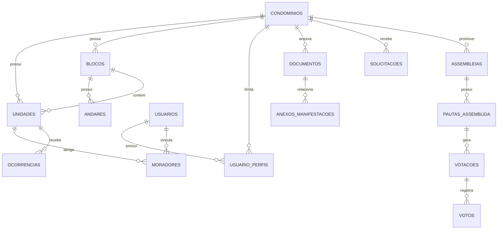

# Modelo de dados

O arquivo editável principal é `database/dwello.sql`. Ele contém criação de tabelas, índices e relacionamentos. A configuração do Drizzle é baseada em `src/db/dwello-schema.ts`. O diagrama editável está em `docs/modelo-dados.mmd` e sua versão imprimível em `docs/modelo-dados.pdf`.

## Relacionamentos principais

- Condomínio contém blocos, unidades, pessoas e registros operacionais.
- Unidade pertence a um condomínio e pode estar associada a moradores.
- Usuário possui um ou vários vínculos de perfil por condomínio.
- Ocorrências pertencem a unidades e podem possuir evidências.
- Solicitações e manifestações são relacionadas ao condomínio e aos usuários envolvidos.
- Assembleias contêm pautas, votações e votos.
- Documentos são associados ao condomínio e podem usar arquivos armazenados fora do banco.
